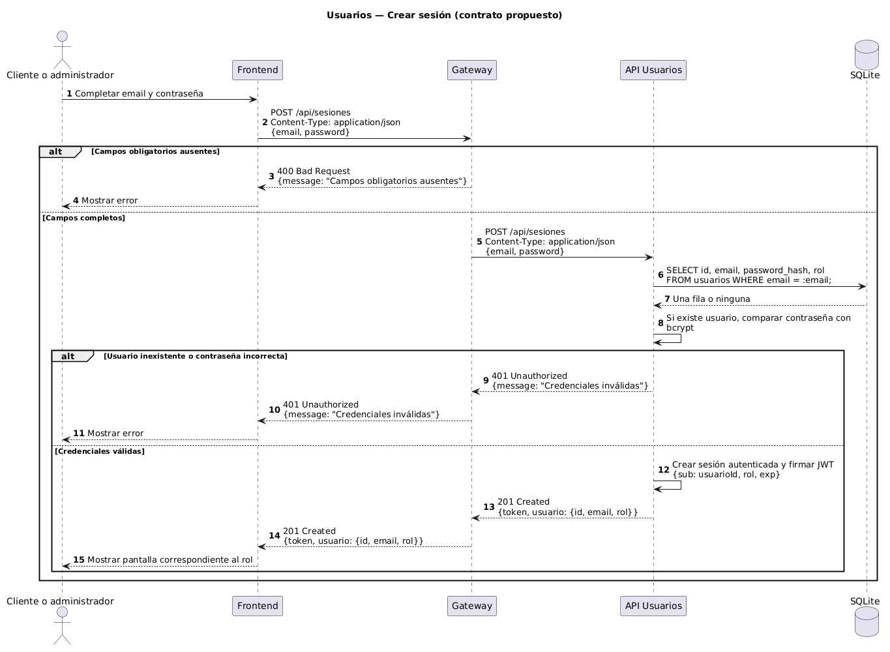
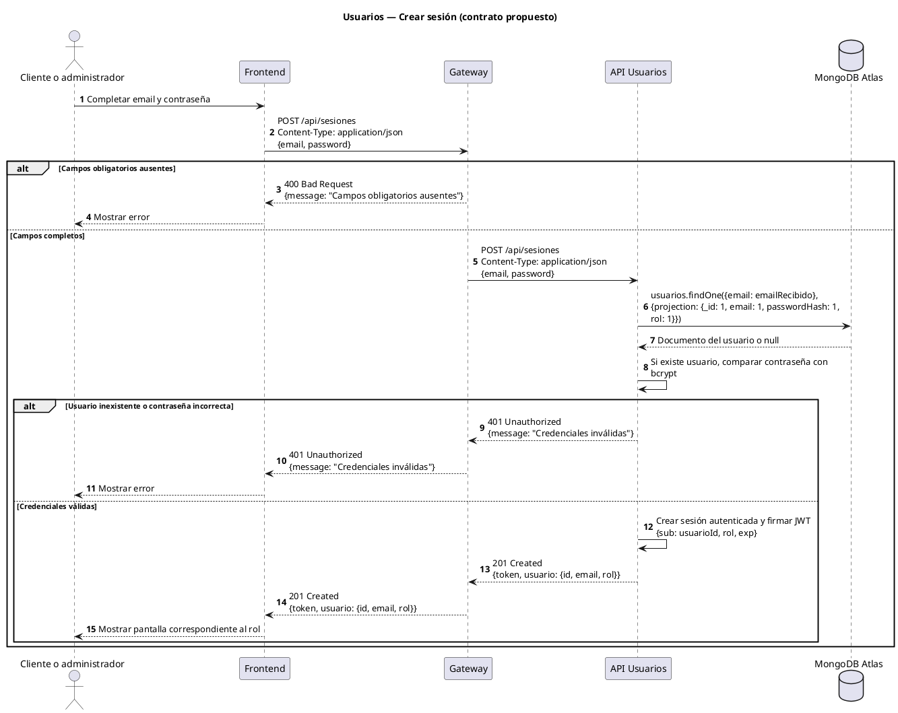
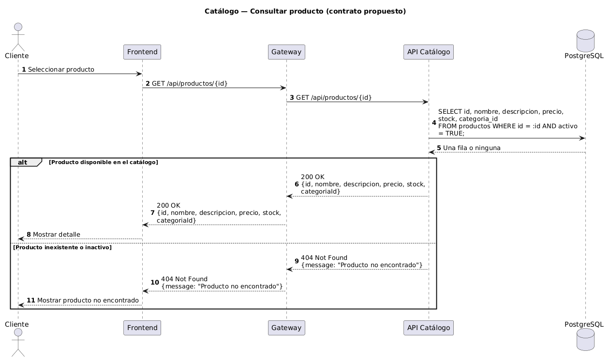
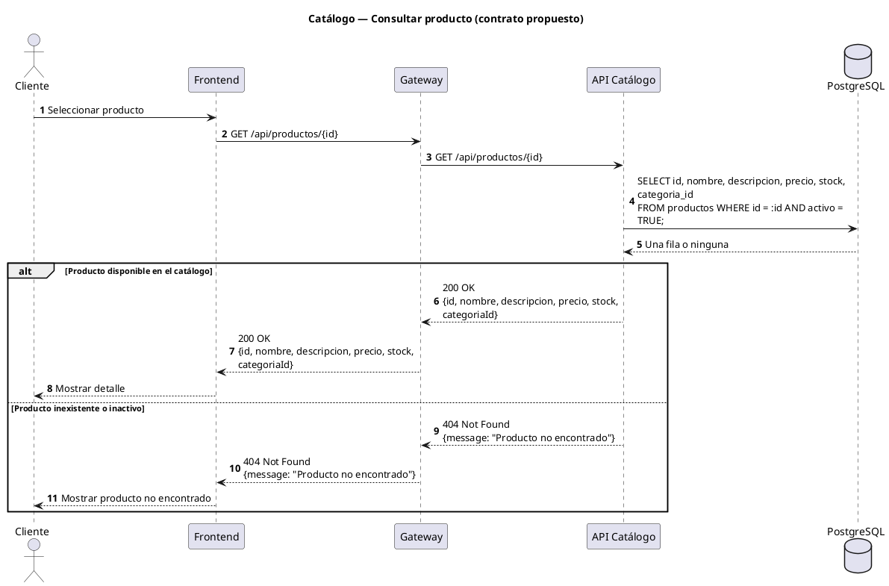
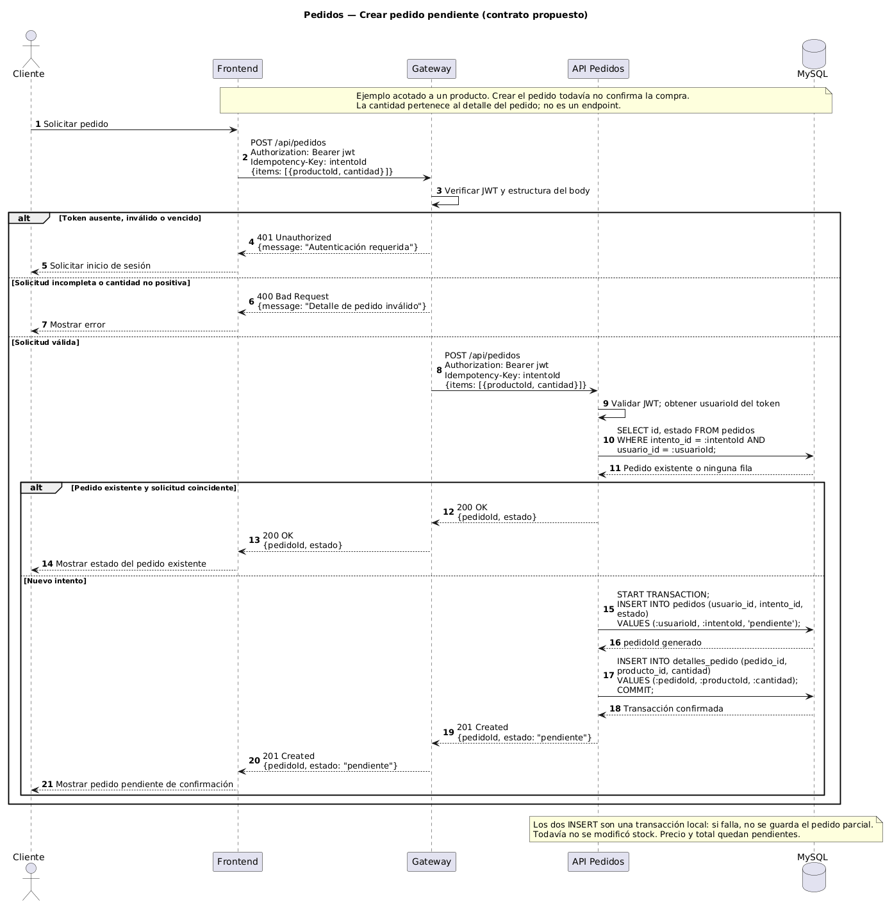
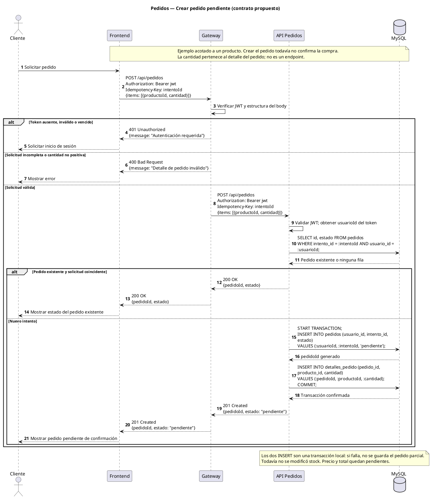
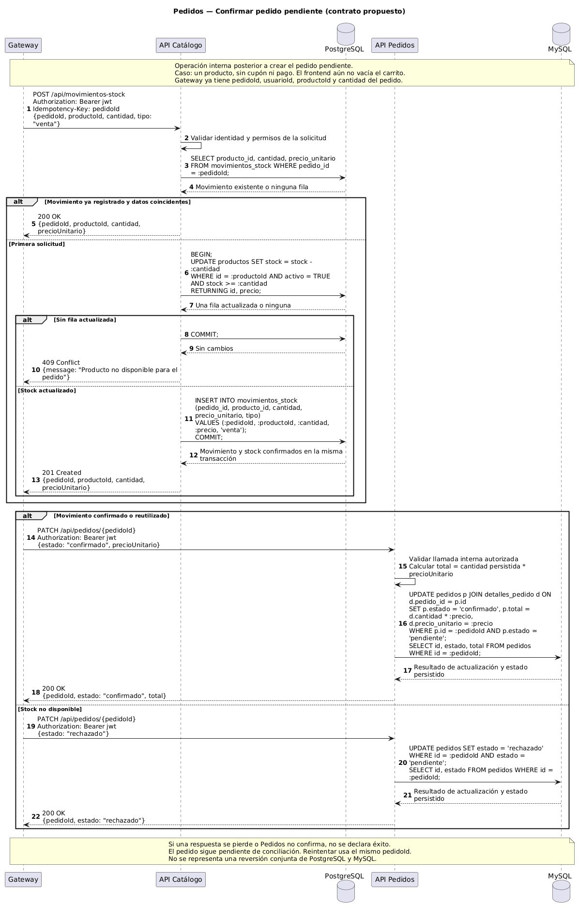
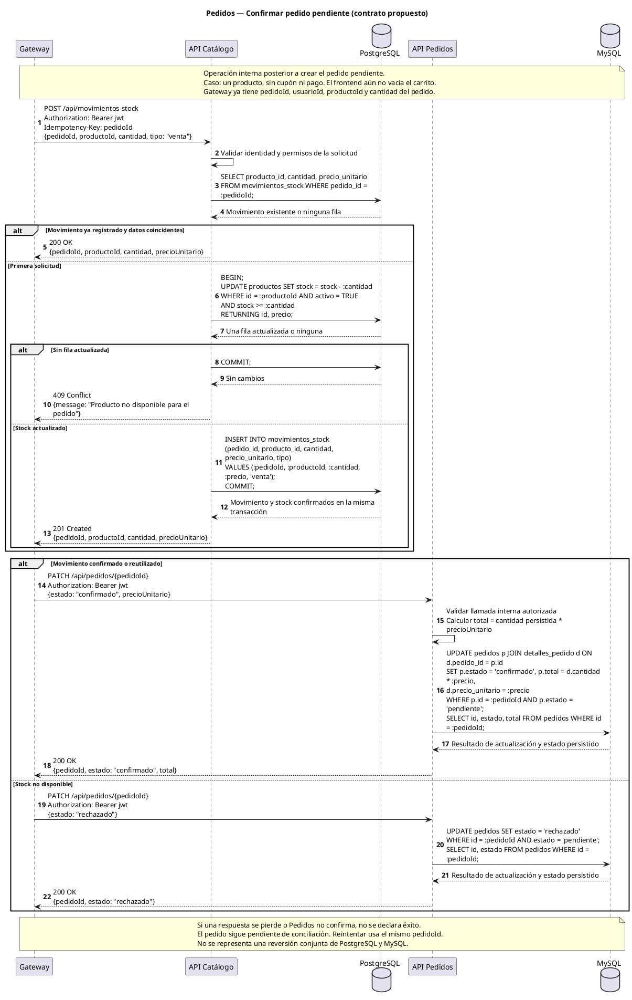

# Tienda Online — EcommerceApp2

### **PP3 — Desarrollo y Aplicación de Sistemas en la Nube · IFTS Nº16**

Docente: Damián Wajser

#

#### **Integrantes**

- Lucía Corral
- Pablo Demartini
- Carla Guisande
- Ignacio Hernandez
- Ignacio Vidal

#

#

## 1. De qué se trata el proyecto

**Tienda Online** es una aplicación web de comercio electrónico dirigida a pequeños comercios que venden productos de tecnología y artículos para el hogar. Permite que sus clientes consulten el catálogo, busquen por nombre, filtren por categoría, agreguen productos al carrito y confirmen una compra. Los usuarios pueden registrarse e iniciar sesión, mientras que el personal autorizado dispone de una dashboard administrativo para gestionar el stock de productos y alta y baja de productos y de usuarios.

El problema que busca resolver es la dispersión de la información de venta: cuando un comercio recibe consultas por mensajes y mantiene precios y existencias en listas separadas, el cliente necesita consultar qué está disponible y el personal debe revisar los datos para cada operación. La aplicación reúne el catálogo, los precios y el stock en una misma plataforma; durante el checkout, el servidor verifica la disponibilidad y calcula el total a partir de los precios guardados en la base de datos.

El público objetivo comprende dos tipos de usuarios: **clientes** que quieren consultar productos y preparar sus compras desde un navegador, y **administradores** que necesitan mantener la información del comercio.

Para los _clientes_, el beneficio es contar con un catálogo consultable y una confirmación inmediata del checkout.
Para los _administradores_, es gestionar los datos desde una interfaz común.

## 2. Arquitectura propuesta y despliegue previsto

El sistema dispone de un frontend para la tienda y el dashboard administrativo. Las solicitudes del frontend ingresan por un API Gateway, que se comunica con las APIs de Usuarios, Catálogo y Pedidos. Cada API administra su propia base de datos.

**El alojamiento indicado es previsto; este documento no certifica que los componentes ya estén desplegados. Los nombres de carpetas son propuestos y deben verificarse contra el repositorio de implementación.**

| Componente                       | Carpeta propuesta          | Tecnología             | Despliegue previsto |
| -------------------------------- | -------------------------- | ---------------------- | ------------------- |
| Frontend Web: tienda y dashboard | `frontend/`                | HTML, CSS y JavaScript | Vercel              |
| API Gateway                      | `api-gateway/`             | Node.js y Express      | Render              |
| API Usuarios                     | `ms-usuarios/`             | Node.js y Express      | Render              |
| API Catálogo                     | `ms-catalogo/`             | Node.js y Express      | Render              |
| API Pedidos                      | `ms-pedidos/`              | Node.js y Express      | Render              |
| DB Usuarios                      | Base exclusiva de Usuarios | MongoDB                | MongoDB Atlas       |
| DB Catálogo                      | Base exclusiva de Catálogo | PostgreSQL             | Render Postgres     |
| DB Pedidos                       | Base exclusiva de Pedidos  | MySQL                  | Railway             |

### Vista general del sistema

[Ver imagen de arquitectura en tamaño completo](diagramas/diagArq.jpg)

## Responsabilidades y comunicación

**Estado del documento:** diseño propuesto. Las rutas, tablas y columnas que siguen requieren acuerdo del equipo y adaptación del código; no se presentan como una implementación verificada.

| Componente   | Responsabilidad                                                       | Base propia               |
| ------------ | --------------------------------------------------------------------- | ------------------------- |
| Frontend Web | Tienda y dashboard administrativo; consume únicamente el Gateway.     | .                         |
| API Gateway  | Valida JWT, enruta solicitudes y coordina la confirmación de pedidos. | .                         |
| API Usuarios | Usuarios, roles y autenticación.                                      | MongoDB en MongoDB Atlas. |
| API Catálogo | Productos, precios, existencias y movimientos de stock.               | PostgreSQL.               |
| API Pedidos  | Pedido, sus detalles y estado.                                        | MySQL.                    |

Cada API accede únicamente a su base. El Gateway no ejecuta SQL. Las solicitudes HTTP incluyen método, ruta y datos; las solicitudes a PostgreSQL y MySQL muestran SQL parametrizado; las consultas a MongoDB muestran operaciones del driver. Las respuestas de las bases muestran resultados, sin códigos HTTP.

La arquitectura general se documenta aparte, con componentes, alojamientos previstos y comunicaciones, sin endpoints. No se utiliza un diagrama de secuencia como sustituto de la arquitectura.

---

## 3. Diagramas de secuencia

Cada diagrama representa una operación independiente y reinicia su numeración. Las imágenes PNG muestran los diagramas renderizados. Cada una incluye un enlace para abrirla en tamaño completo. Los bloques PlantUML permiten mantener sus fuentes; GitHub no renderiza esos bloques automáticamente. No se reúnen autenticación, consulta de productos y compra dentro de una vista general.

### 1 — Crear sesión

Este diagrama muestra únicamente la autenticación de un cliente o administrador. El frontend envía las credenciales al Gateway y API Usuarios busca el usuario en MongoDB Atlas. La contraseña se verifica antes de crear la sesión y emitir el JWT. Se distinguen los casos de campos ausentes, credenciales inválidas y autenticación correcta.

**Contrato propuesto:** POST /api/sesiones crea una sesión autenticada: 201 en el caso nuevo; 400 si faltan campos y 401 si las credenciales no son válidas.

[Ver este diagrama en tamaño completo](diagramas/01-sesion.png)

Ver código PlantUML de este diagrama

 

---

 

### 2 — Consultar producto

Este diagrama muestra únicamente la consulta del detalle de un producto. El frontend solicita el producto por su identificador; Gateway deriva la solicitud a API Catálogo, que consulta PostgreSQL. La respuesta permite mostrar el detalle o informar que el producto no se encuentra.

**Contrato propuesto:** GET /api/productos/{id}: 200 si existe y está activo; 404 si no se encuentra.

[Ver este diagrama en tamaño completo](diagramas/02-producto.png)

Ver código PlantUML de este diagrama

 

---

 

### 3 — Crear pedido pendiente

Este diagrama muestra únicamente la creación de un pedido pendiente. El cliente envía el detalle del pedido y API Pedidos lo registra en MySQL junto con sus artículos. En esta operación todavía no se descuenta stock ni se declara la compra confirmada. El ejemplo está acotado a un producto y contempla la reutilización de un pedido existente para evitar duplicaciones.

**Contrato propuesto:** POST /api/pedidos: 201 si crea un pedido pendiente; 200 si reutiliza uno existente con la misma clave y solicitud; 400 si el detalle no es válido y 401 si falla la autenticación.

[Ver este diagrama en tamaño completo](diagramas/03-pedido.png)

Ver código PlantUML de este diagrama

 

---

 

### 4 — Confirmar o rechazar el pedido

Este diagrama muestra únicamente la confirmación de un pedido previamente creado. Gateway coordina el movimiento de stock en API Catálogo y la actualización del estado en API Pedidos. Si el producto no está disponible, se propone rechazar el pedido. Si una respuesta se pierde o la confirmación falla después de modificar stock, la operación requiere conciliación; no se declara una compra exitosa.

**Contrato propuesto:** POST /api/movimientos-stock: 201 para el nuevo movimiento, 200 para un resultado existente coincidente y 409 cuando no se puede atender el pedido. PATCH /api/pedidos/{pedidoId}: 200 cuando se actualiza o se recupera el estado confirmado.

[Ver este diagrama en tamaño completo](diagramas/04-confirmacion.png)

Ver código PlantUML de este diagrama

 

---

 

### Contratos propuestos

| Origen → destino              | Solicitud                       | Resultado principal                                          |
| ----------------------------- | ------------------------------- | ------------------------------------------------------------ |
| Frontend → Gateway → Usuarios | `POST /api/sesiones`            | `201 Created`, token y usuario autenticado.                  |
| Frontend → Gateway → Catálogo | `GET /api/productos/{id}`       | `200 OK`, detalle del producto.                              |
| Frontend → Gateway → Pedidos  | `POST /api/pedidos`             | `201 Created`, pedido pendiente.                             |
| Gateway → Catálogo            | `POST /api/movimientos-stock`   | `201 Created`, movimiento registrado con precio de Catálogo. |
| Gateway → Pedidos             | `PATCH /api/pedidos/{pedidoId}` | `200 OK`, estado persistido del pedido.                      |

Las rutas identifican recursos mediante sustantivos. Crear un movimiento de stock es distinto de usar una ruta con un verbo como `/descontar`. No se incluye una ruta de pagos porque estos diagramas no registran pagos.

### Alcance y consistencia

- La creación del pedido y su detalle se realiza dentro de una transacción local en MySQL. Si falla, no debe persistir un pedido parcial. En esta etapa no se modificó el stock.
- Catálogo registra el movimiento y modifica el stock dentro de una misma transacción local en PostgreSQL.
- La cantidad es un campo del detalle, no una ruta. Los ejemplos de pedidos incluyen un solo producto; el caso de varios productos requiere una transacción de inventario para el conjunto completo.
- La idempotencia requiere restricciones únicas, comparación del contenido y manejo de solicitudes simultáneas. Un SELECT previo por sí solo no evita duplicaciones. La misma clave con contenido diferente debe rechazarse con `409 Conflict`.
- Gateway debe consultar el estado durable del pedido antes de continuar o reintentar la confirmación. Un pedido confirmado o rechazado no vuelve a procesarse como un pedido nuevo.
- Si stock quedó aplicado y la confirmación del pedido no se completa, el pedido permanece pendiente de conciliación. El reintento debe recuperar el movimiento existente y continuar, sin volver a descontar unidades.
- Esa conciliación debe implementarse de manera durable en los servicios, incluida la recuperación después de reinicios. No queda resuelta únicamente por dibujar los mensajes HTTP.
- Los ejemplos muestran validaciones y errores de negocio. Los fallos de persistencia y red necesitan tratamiento adicional y nunca deben producir una confirmación falsa.
- Eliminar la compensación anterior del diagrama no elimina las transacciones locales: una transacción local fallida debe cancelarse. No existe una única transacción que abarque ambas bases.
- Pedidos obtiene la identidad del JWT. Solo llamadas internas autorizadas pueden establecer precios y cambiar el estado a confirmado o rechazado. El precio procede de Catálogo y el total se calcula en el servidor.
- El frontend muestra la compra confirmada y vacía el carrito únicamente al conocer el estado confirmado. La respuesta `201` de un pedido pendiente no alcanza. La limpieza de un carrito persistido en Usuarios requiere coordinación adicional.
- Los pagos, cupones y comprobantes tendrán sus propios diagramas cuando se definan sus contratos. No se afirma que hayan sido eliminados del alcance del proyecto.

### Correspondencia con la arquitectura

Usuarios utiliza MongoDB Atlas; Catálogo utiliza PostgreSQL; Pedidos utiliza MySQL. El frontend consume únicamente Gateway y ninguna API consulta directamente la base de otra.

El sistema comprende cuatro procesos backend contando el Gateway: Gateway, Usuarios, Catálogo y Pedidos. Son tres APIs de dominio y tres bases propias. Los alojamientos previstos se mantienen en la sección de despliegue.
